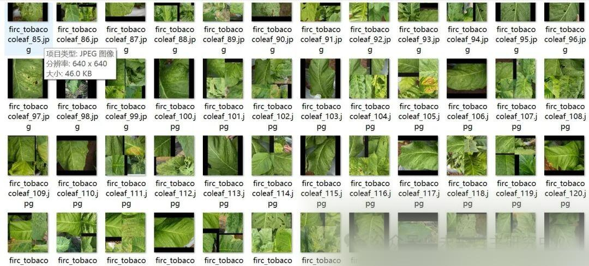
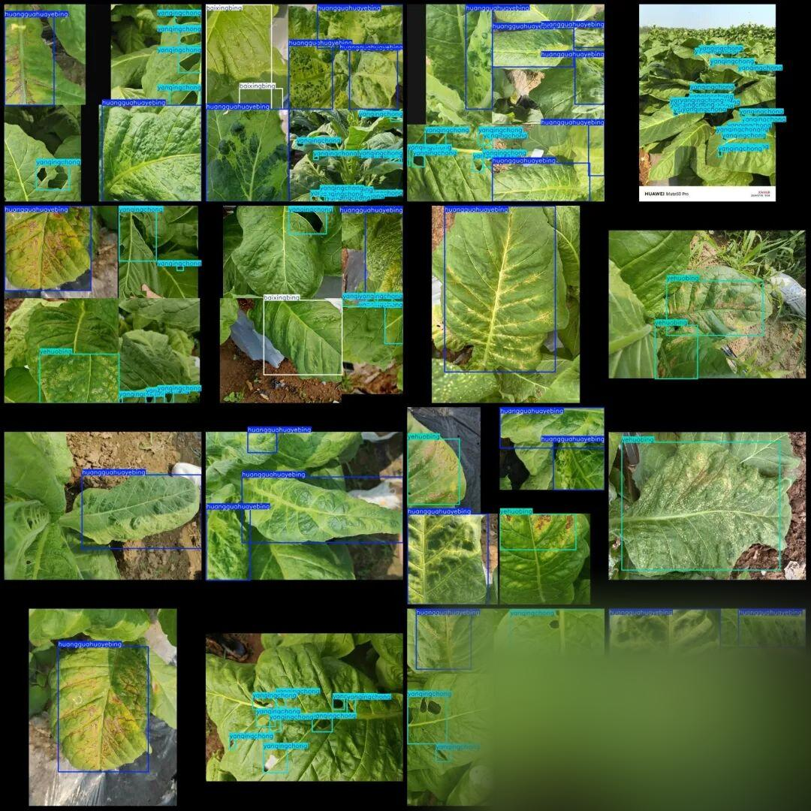

# Tobacco Leaf Disease Detection Dataset in VOC+YOLO format with 1555 images and 4 categories with enhanced features

Dataset 650 consists of the original images, while the remaining are enhanced images. The enhancement method is stitching, which can be seen in the images.

Dataset format: Pascal VOC format + YOLO format (txt file without split path, only containing jpg images and corresponding VOC format xml files and yolo format txt files)

Number of images (number of jpg files): 1555

Number of annotations (number of xml files): 1555

Number of annotations (number of txt files): 1555

Labeling category count: 4

Label category names (note that the format of YOLO does not correspond to this, but rather follows the order in the labels folder's classes.txt): ["baixingbing", "huangguahuayebing", "yanqingchong", "yehuobing"] => [Baixing Bing, Huanggua Hua Ye Bing, Yanqing Chong, Yehuo Bing]

Number of boxes labeled in each category:

Baixingbing frame count = 919

huangguahuayebing frame count = 1924

Yanqingchong Frame Count = 5867

Yehuobing Frame Count = 824

Total frame count: 9534

Using labelImg:

Annotation rules: Draw a rectangle around the category.

Important Notice: No

Special : This dataset does not guarantee the accuracy or precision of the trained models or weight files. The dataset is provided with accurate and reasonable annotations only.

Image Preview:

Annotation example:

## Payment

Here is a pay link on Stripe ( https://buy.stripe.com/3cs8yP7sY87d0vu9AB ). Please contact me lonlonago@foxmail.com after funding $89, and I will send you a complete data files , thank you!

